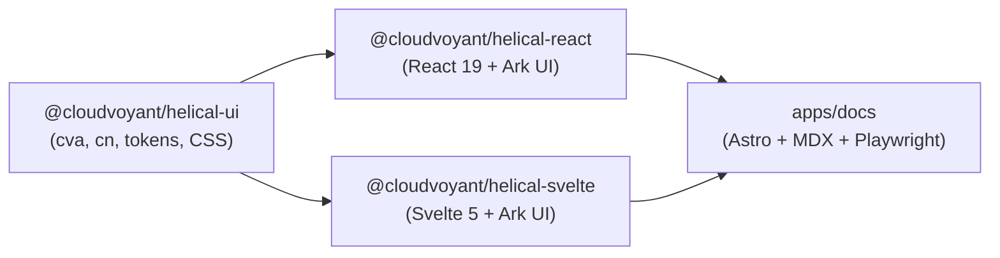

# Repository Guidance

## Hard Rules

- Run tasks via `mise run <task>` ([mise.toml](mise.toml), [mise-tasks/](mise-tasks/), [package.json](package.json)).
- Manage packages and shared catalog versions in [pnpm-workspace.yaml](pnpm-workspace.yaml) with `pnpm`.
- Scaffold architecture, planning, and component design docs with `difflab templates scaffold`.
- Format commits as Conventional Commits (`<= 72` chars, imperative, no trailing period, no AI self-attribution; see [.releaserc.json](.releaserc.json)).
- Keep `@cloudvoyant/helical-ui` framework-agnostic (no `react`, `svelte`, or `@ark-ui/*` imports).
- Never modify template scripts (`mise-tasks/utils`, `mise-tasks/upversion`, `version.txt`).

## Organization

- [Proposed] Keep component-specific core logic and state machines in `libs/helical-ui` rather than `libs/utils`; reserve `libs/utils` for generic, domain-independent helpers.
- Split multi-concern component modules in `libs/helical-ui/src/` into a `<component>/` directory with separate `types.ts`, `core.ts`, `styles.ts`, and `index.ts` files rather than a single monolithic file.
- [Proposed] Compose or reuse shared prop interfaces from `libs/helical-ui` across components instead of duplicating equivalent prop definitions per component.
- [Proposed] Put shared controller synchronization, persistence, and DOM discovery in `libs/helical-ui` and framework hooks rather than app-level shell components.
- Keep main component types and public utilities on the `@cloudvoyant/helical-ui` barrel root; expose only internal component helpers that consumers are discouraged from calling directly via subpath exports (e.g., `@cloudvoyant/helical-ui/commands`).

### Repository layout



```text
.
├── libs/
│   ├── helical-ui/src/
│   │   ├── <component>.ts            # Shared types, constants, cva variants
│   │   ├── theme.css                 # Shadcn design tokens (light/dark)
│   │   └── components.css            # Keyframes & third-party selector overrides
│   ├── helical-react/src/<component>/ # Thin React Ark UI wrappers (PascalCase.tsx)
│   └── helical-svelte/src/<component>/# Thin Svelte 5 runes wrappers (PascalCase.svelte)
├── apps/docs/
│   ├── src/content/components/<component>.mdx
│   ├── src/components/examples/<component>/<example>/{react.tsx,svelte.svelte}
│   ├── src/vite/                     # Docs Vite pre-transform plugins
│   └── e2e/<component>.spec.ts
└── docs/
    └── architecture/
        ├── index.md                  # Monorepo & library architecture
        ├── docs-site.md              # Docs/demo app & Vite plugin architecture
        └── components/<component>.md # Component architecture docs
```

- Use `kebab-case` for directories and shared `.ts`/`.mdx` files; use `PascalCase` for component files and exports. See [docs/architecture/index.md](docs/architecture/index.md).
- [Proposed] Keep custom Vite plugins for `apps/docs` in `apps/docs/src/vite/` and document their role and transform flow in [docs/architecture/docs-site.md](docs/architecture/docs-site.md).

### File layout

Order every module and component file from top to bottom (`1. Imports`, `2. Module constants & types`, `3. Local helpers / hooks`, `4. Exported functions / components`), and use explicit section headers inside stateful components (`// --- State ---`, `// --- Effects ---`, `// --- Methods ---`, `// --- Helpers ---`, `// --- Render ---`) in that exact order (only include `// Source:` when the file is a near-direct copy of an upstream reference):

```tsx
// 1. Imports
import { forwardRef, useEffect, useMemo, useRef, useState } from 'react';
import { cn, widgetVariants, type WidgetVariantProps } from '@cloudvoyant/helical-ui';

// 2. Module constants & types
export interface WidgetProps extends WidgetVariantProps { ... }

// 3. Local helpers / hooks
function resolveState(...) { ... }

// 4. Exported component
export const Widget = forwardRef<HTMLDivElement, WidgetProps>((props, ref) => {
  // --- State ---
  // --- Effects ---
  // --- Methods ---
  // --- Helpers ---
  // --- Render ---
});
```

- Start every script in `mise-tasks/` with `set -euo pipefail` and `source "${MISE_PROJECT_ROOT}/mise-tasks/utils"`.

## Style

### TypeScript and CSS

- Split `cva` variants into orthogonal axes (`variant`, `color`, `size`), use theme tokens from [theme.css](libs/helical-ui/src/theme.css), and merge user `className` last with `cn`:

```ts
export const badgeVariants = cva('inline-flex items-center', {
  variants: {
    variant: { solid: 'bg-primary text-primary-foreground', outline: 'border border-border' },
    size: { sm: 'px-2 py-0.5 text-xs', md: 'px-2.5 py-1 text-sm' },
  },
  defaultVariants: { variant: 'solid', size: 'md' },
});
```

- Prioritize typing and autocomplete ergonomics for consumers; export multi-part component styles as a grouped object (e.g., `commandPaletteStyles`, `commandMenuStyles`, `themeSelectorStyles`) rather than flat individual style constants.
- [Proposed] Keep inline comments terse and last-resort; express intent through self-descriptive identifiers and move rationale into `docs/architecture/components/<component>.md`.
- Document all exported public functions, classes, and public methods with TSDoc comments.
- [Proposed] Document complex UI components with `difflab templates scaffold ui-component-architecture`, using Mermaid diagrams for state transitions and data flow.
- [Proposed] Keep `Behavior` and `Public API` sections in `docs/architecture/components/<component>.md` terse and in plain English; explain component wiring and runtime mechanics with Mermaid diagrams under `Design` and `Implementation` rather than prose paragraphs.
- [Proposed] Prefer Tailwind utilities and `cva` variants in `libs/helical-ui/src/<component>.ts` over raw rules in [components.css](libs/helical-ui/src/components.css), reserving `components.css` for `@keyframes` or third-party selector overrides.

### React and Svelte

- Keep wrappers thin, maintain prop parity across React and Svelte 5 runes (`$props`, `$derived`, `$state`), and compose layouts with helical-ui primitives (`Container`, `Row`, `Col`, `Stack`, `HStack`, `VStack`, `Center`):
- [Proposed] Provide identically typed hooks (e.g., `useTheme`) across `@cloudvoyant/helical-react` and `@cloudvoyant/helical-svelte` backed by shared state in `@cloudvoyant/helical-ui`, and pass configuration such as custom themes to hooks or providers rather than picker components.
- [Proposed] Support uncontrolled usage (internal state fallback when `open` or `value` is omitted) on interactive overlay and menu components so consumers do not have to wire external state for basic usage.
- [Proposed] Expose composable subcomponents and shared context hooks for multi-part interactive components while rendering a default composition when children are omitted.
- Keep documentation examples in `apps/docs/src/components/examples/` self-contained with hardcoded sample data and minimal UI; omit `data-testid` attributes, docs-shell state subscriptions, status readouts used only to prove effects, and explanatory prose that belongs in the surrounding MDX page.

```tsx
// React (libs/helical-react/src/<component>/Root.tsx)
export const Widget = forwardRef<HTMLDivElement, WidgetProps>(
  ({ variant, size, className, ...props }, ref) => (
    <ArkWidget.Root ref={ref} className={cn(widgetVariants({ variant, size }), className)} {...props} />
  ),
);
```

```svelte
<!-- Svelte 5 (libs/helical-svelte/src/<component>/Root.svelte) -->
<script lang="ts">
  let { variant, size, class: className, children, ...rest }: WidgetProps = $props();
</script>
<ArkWidget.Root class={cn(widgetVariants({ variant, size }), className)} {...rest}>
  {@render children?.()}
</ArkWidget.Root>
```

## Testing

| Layer | Location | Focus |
| :--- | :--- | :--- |
| Unit (`vitest`) | `libs/*/tests/*.test.ts` | Variant output, helpers, and pure state logic |
| E2E (`playwright`) | `apps/docs/e2e/<component>.spec.ts` | ARIA state, keyboard navigation, and parity across React & Svelte islands |

- Organize Playwright E2E specs in `apps/docs/e2e/` under `test.describe('<Component> · ${framework}')` using meaningful state/configuration contexts for `Given` (`test.describe('Given ...')`), single user actions for `When` (`test.describe('When ...')`) with shared setup/actions in `test.beforeEach`, and focused outcome assertions in `test('it ...')`.
- [Proposed] Prefer Playwright E2E tests on the demo site over mocked DOM (`vi.stubGlobal`) unit tests for browser-dependent behaviors like focus management, media queries, and document class synchronization.
- Keep component E2E specs focused on component behavior rather than docs shell integration; exclude any agent-debugging docs-shell specs from CI E2E runs.

Validate before committing (see [docs/development-guide.md](docs/development-guide.md)):

```sh
mise run build && mise run test && mise run lint && mise run format:check && mise run e2e
```
