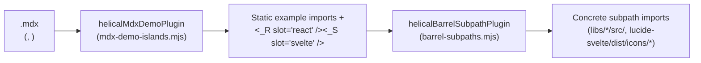

# helical-ui architecture

## Monorepo layout

helical-ui is a pnpm workspace monorepo:

- `libs/helical-ui` — shared interfaces, cva variants (`buttonVariants`, `toggleButtonVariants`, `badgeVariants`), `cn` utility, and the shadcn-style theme (CSS variables, light + dark). Publishes to npm.
- `libs/helical-react` — React UI components built on Ark UI (Button, ToggleButton, Badge). Publishes to npm.
- `libs/helical-svelte` — Svelte UI components built on Ark UI (Button, ToggleButton, Badge), packaged with `@sveltejs/package`. Publishes to npm.
- `apps/docs` — Astro docs/demo app, `private: true` (never published). MDX content collection, shadcn-style shell, React/Svelte framework selector, live component demos.

## Workspace config

- `pnpm-workspace.yaml` — workspace globs (`apps/*`, `libs/*`), shared dependency catalog (`catalogMode: manual`).
- `tsconfig.base.json` — shared strict TypeScript base; each package extends it.
- `version.txt` — single source of truth for the lockstep version shared by all packages.
- `mise-tasks/set-version` — fans a version out to every `libs/*/package.json` and `apps/*/package.json`.

## Docs app conventions

- `apps/docs` uses Astro 7 with `@astrojs/react`, `@astrojs/svelte`, `@astrojs/mdx`, and Tailwind v4 via `@tailwindcss/vite`.
- The theme lives in `@cloudvoyant/helical-ui/src/theme.css` and matches shadcn/ui's implementation (CSS variables under `:root`/`.dark`, `@theme inline`, `@custom-variant dark`).
- The framework selector persists to `localStorage` (`vortex:framework`) and sets `data-framework` on `<html>`; `Demo.astro` renders `<slot name="react" />` and `<slot name="svelte" />` inside `[data-fw]` wrappers and CSS shows the active framework.
- To add a new demo, create a folder under `apps/docs/src/components/examples/{component}/{name}` containing `react.tsx` and `svelte.svelte`. No router registration or codegen step is required.

### Docs Vite plugins (`apps/docs/src/vite/`)

Because Astro's `client:*` hydration directives only work on statically imported components and `astro dev` serves unbundled ES modules over HTTP, `apps/docs` uses two `enforce: 'pre'` Vite plugins wired in [`apps/docs/astro.config.mjs`](../apps/docs/astro.config.mjs):

1. **`helicalMdxDemoPlugin` ([`apps/docs/src/vite/mdx-demo-islands.mjs`](../apps/docs/src/vite/mdx-demo-islands.mjs)):**
   - Runs before `@astrojs/mdx` to expand `<Examples component="..." />` and self-closing `<Demo component="..." example="..." />` tags in `.mdx` files into `<Demo>` elements with named slot children (`<_R_... slot="react" client:load />` and `<_S_... slot="svelte" client:load />`) and injects static `import` statements for only that page's examples.
   - Accepts configurable `previewFrameComponents` (left self-closing because `<Demo>` renders an `<iframe data-preview>` via `PreviewFrame.astro`), `ssrExamples` (slotted without `client:*` directives so they render pure server HTML with zero client JS), and `clientOnlyComponents` (slotted with `client:only="react"` / `client:only="svelte"`).
2. **`helicalBarrelSubpathPlugin` ([`apps/docs/src/vite/barrel-subpaths.mjs`](../apps/docs/src/vite/barrel-subpaths.mjs)):**
   - Parses `libs/helical-{ui,react,svelte}/src/index.ts` and `lucide-svelte/dist/icons/index.js` at build start and rewrites static named imports/exports (and Astro hydrated island `client:component-path` metadata) to their concrete subpath files (skipping `?raw` code-tab imports and `node_modules`).
   - Prevents `astro dev` from requesting every component in the workspace barrel or all 1,500+ `lucide-svelte` icons on page load, and keeps Rollup chunks isolated per component in `astro build`.

## Component pattern

Every component follows the Button pattern: a shared cva variant function lives in `@cloudvoyant/helical-ui`, and `@cloudvoyant/helical-react`/`@cloudvoyant/helical-svelte` expose thin wrappers that apply `cn(<variants>, className)` over an Ark UI primitive. Composite components (ToggleButton) are composed from per-part exports matching Ark's anatomy.

The overlay components (Popover, Dialog, Window, Tooltip) extend this pattern: their shared Tailwind base classes live in `@cloudvoyant/helical-ui` (e.g. `popoverContentBase`), the framework wrappers are thin `cn(base, className)` pass-throughs, and the content/backdrop parts swallow the Ark `Portal` + `Positioner` internally so consumers never compose them (`Window` goes furthest — its root swallows the positioner and content, so children are the window parts directly). Ark's `CloseTrigger` is exported as `Dismiss` with a baked-in `aria-label`, and the arrow is an internal detail toggled via an `arrow` prop on content. A `Portal` layout primitive is exported by `@cloudvoyant/helical-react`/`@cloudvoyant/helical-svelte` (documented under Layout) for escaping ancestors in user compositions. Overlay components reuse the existing shadcn theme tokens — no `theme.css` additions.

Component-specific architecture documents live under `docs/components/`:

- [docs/components/sidebar.md](components/sidebar.md) — Sidebar layout, state transitions, and mobile sheet implementation.

## Release pipeline

- `.releaserc.json` — semantic-release. Release rules cap every bump at `minor` (stay-at-v0).
- `mise-tasks/upversion` — runs semantic-release.
- `mise-tasks/publish` / `publish:rc` — publish public workspace packages to npm (skips private, idempotent).
- `.github/workflows/ci.yml` — CI (install, test, format, lint, RC publish on non-main pushes).
- `.github/workflows/release.yml` — release on main.

## CI secrets

- `NPM_TOKEN` — used as `NODE_AUTH_TOKEN` for publishing to npm.
