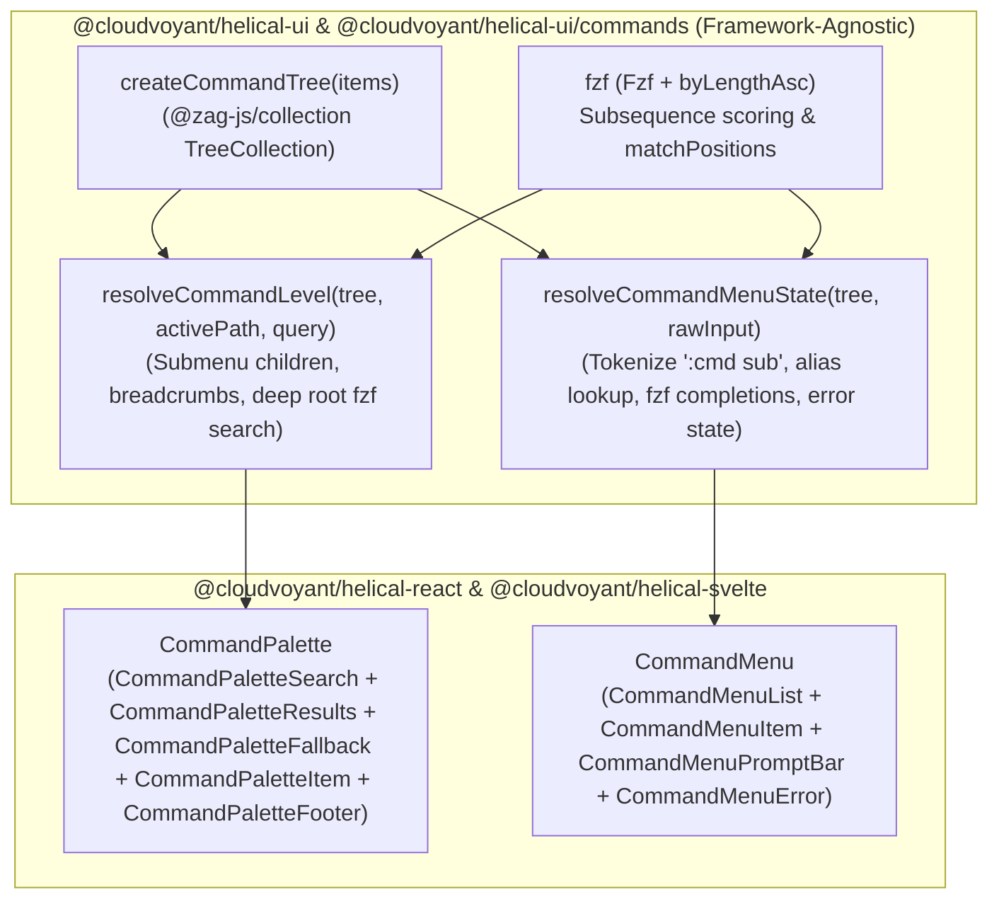
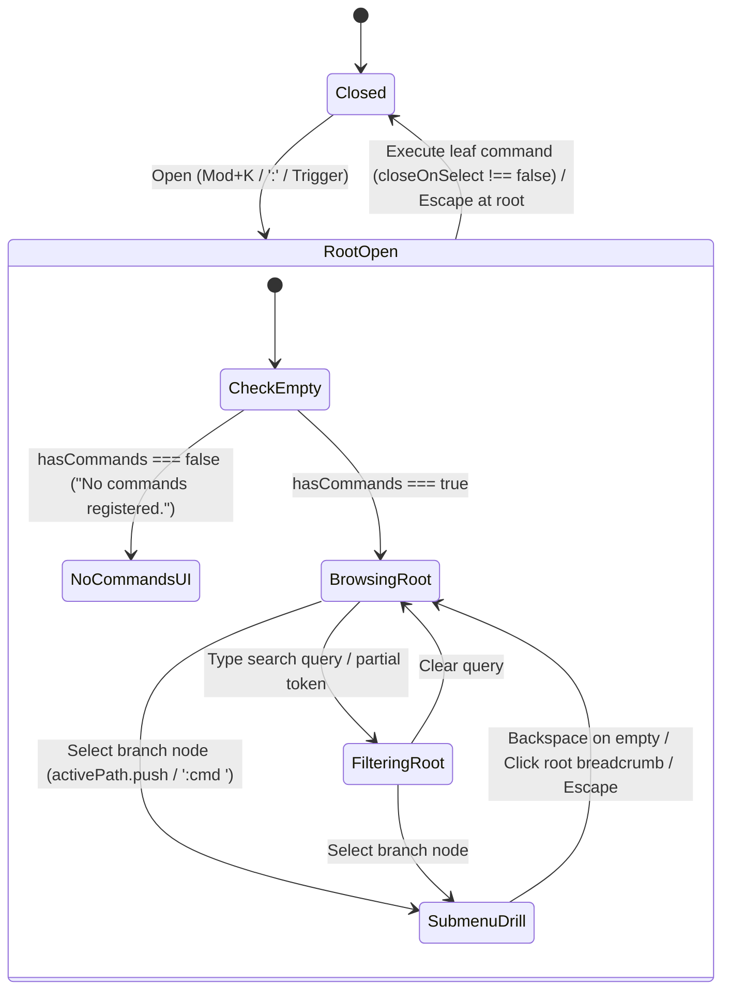

# CommandPalette and CommandMenu

## Overview

`CommandPalette` (`⌘K` / `Ctrl+K`) and `CommandMenu` (`:menu`) provide two keyboard-first navigation surfaces for `@cloudvoyant/helical-react` and `@cloudvoyant/helical-svelte`, powered by a shared hierarchical command tree (`TreeCollection<CommandNode>`) and fuzzy subsequence ranker (`fzf`) in `@cloudvoyant/helical-ui`.

- **`CommandPalette`**: A traditional shadcn-style modal (or inline) command palette with fuzzy search, grouped items, keyboard shortcut badges (`<Kbd>`), and multi-level nested submenu drill-down with breadcrumb pills (without showing `:colon` tokens).
- **`CommandMenu`**: A Helix/Kakoune-inspired `:` command-line prompt and multi-column completion popup docked across the bottom of the viewport (`columns="auto"`, `size="sm" | "md" | "lg"`), supporting `:command <subcommand> <arg>` token parsing, aliases, `Tab` completion, nested subcommand menus, and inline error diagnostics.
- **`Toast` (`Toaster`, `ToastItem`, `toast`)**: A portaled Ark UI toast notification store and overlay used by command consumers (`CommandPalette`, `CommandMenu`) to announce command execution feedback.

## Design

### Layout

```text
CommandPalette (Modal or Inline):
+-----------------------------------------------------------------------+
| [Search Icon]  [Breadcrumb ›]  Type a command or search...     [Esc]  |
|-----------------------------------------------------------------------|
| Navigation                                                            |
|   Search Docs                                       [Future]  [Mod+f] |
|   View GitHub                                                   [g h] |
| Appearance                                                            |
|   Change Theme                                                    [›] |
|   Change Light/Dark Mode                                          [›] |
|-----------------------------------------------------------------------|
| ↑↓ Navigate   ↵ Select / Drill in   ⌫ Back   Esc Close                |
+-----------------------------------------------------------------------+

CommandMenu (bottom-docked, columns="auto", size="sm" | "md" | "lg"):
+-----------------------------------------------------------------------+
| :search        Search Docs  | :github        View GitHub              |
| :theme         Change Theme | :mode          Change Light/Dark Mode   |
| :keybind       Keybind Style| :framework     Change Framework         |
|-----------------------------------------------------------------------|
| : [theme ›] cat                                   [Tab Complete] [↵]  |
+-----------------------------------------------------------------------+
```



### Behavior

- **Default:** Both components accept `items?: CommandNode[]` or a prebuilt `collection?: TreeCollection<CommandNode>`, and manage internal `open` state + default trigger + hotkey (`Mod+k` for `CommandPalette`, `:` for `CommandMenu`) when `open` is omitted. When opened at the root, `CommandPalette` renders top-level commands grouped by `group`, and `CommandMenu` focuses the monospaced `:` input and lists top-level commands.
- **Interaction (`CommandPalette`):** Typing filters commands via `fzf` (`byLengthAsc` tie-breaker) and highlights matched character indices (`matchPositions`) with `<mark>`. Selecting a branch item (`children.length > 0`) pushes `node.value` onto `activePath`, renders a clickable breadcrumb pill, and clears the filter input. Pressing `Backspace` on an empty input (or `Escape` inside a submenu) pops `activePath`. Selecting a leaf item invokes `node.onSelect` and `onSelectCommand`.
- **Interaction (`CommandMenu`):** Typing `:cmd sub` walks `TreeCollection` branches by `command`, `value`, or `aliases`, and ranks child completions for the trailing partial token with `fzf`. Pressing `Tab` autocompletes the highlighted suggestion (`:<command> ` for branch nodes). Pressing `Enter` on a branch node drills into `:<command> `; pressing `Enter` on a leaf node executes it and closes the prompt.
- **Loading, empty, and error:**
  - When zero commands are registered in the tree (`hasCommands === false`), both `CommandPalette` and `CommandMenu` render `"No commands registered."` (`noCommandsText`) in the UI.
  - When commands are registered (`hasCommands === true`) but a query matches zero items, both render `"No matching commands."` (`emptyText`).
  - Submitting an unrecognized command in `CommandMenu` renders an inline error banner (`Unknown command: ...`) without closing the prompt.
- **Accessibility:** Built on Ark UI's `Dialog` and `Listbox` (`ListboxInput autoHighlight`, `ListboxContent`, `ListboxItem`, `ListboxEmpty`) for `role="combobox"` / `role="listbox"` ARIA relationships, `aria-activedescendant` keyboard navigation, focus trapping, and polite `@zag-js/live-region` announcements.

## Implementation

### Public API

- **`@cloudvoyant/helical-ui`**: `createCommandTree`, `matchesCommandHotkey`, `commandPaletteStyles`, `commandMenuStyles`, `CommandNode`, `CommandSelectContext`, `CommandBreadcrumb`, `CommandFlatItem`, `CommandPaletteProps`, `CommandMenuProps`, `CommandMenuColumns`, `CommandStyle`, `CommandContextProps`, `CommandContextValue`, `CommandPaletteVariants`, `CommandMenuVariants`, `toastVariants`, `toasterBase`, `ToastType`, `ToastPlacement`, `ToastActionOptions`, `ToastVariants`.
- **`@cloudvoyant/helical-ui/commands`**: `resolveCommandLevel`, `resolveCommandMenuState`, `formatCommandMenuCompletionInput`, `resolveCommandMenuGridStyle`, `resolveCommandMenuGridNavigation`, `splitHighlightSegments`, `announceCommandMessage`, `shouldHandleCommandHotkey`, `CommandLevelResolution`, `CommandMenuResolution`.
- **`@cloudvoyant/helical-react` & `@cloudvoyant/helical-svelte`**: `CommandPalette`, `CommandPaletteSearch`, `CommandPaletteResults`, `CommandPaletteFallback`, `CommandPaletteItem`, `CommandPaletteFooter`, `useCommandPaletteContext` / `getCommandPaletteContext`, `CommandMenu`, `CommandMenuList`, `CommandMenuItem`, `CommandMenuPromptBar`, `CommandMenuError`, `useCommandMenuContext` / `getCommandMenuContext`, `CommandProvider`, `useCommand` / `getCommandContext`, `Toaster`, `ToastItem`, `ToastRoot`, `ToastTitle`, `ToastDescription`, `ToastActionTrigger`, `ToastCloseTrigger`, `ToastDismiss`, `ToastContext`, `createToaster`, `toast`, `useToast`, `useToastContext`.

### State and Data Flow



### Styling and Responsiveness

- Uses semantic tokens from `@cloudvoyant/helical-ui/src/theme.css` (`--popover`, `--popover-foreground`, `--muted`, `--accent`, `--border`, `--destructive`, `--primary`).
- `commandPaletteVariants` supports `size: 'sm' | 'md' | 'lg'`.
- `commandMenuVariants`, `commandMenuListVariants`, `commandMenuItemVariants`, `commandMenuPromptBarVariants`, and `commandMenuInputVariants` support `size: 'sm' | 'md' | 'lg'` compactness and `columns: 'auto' | 1 | 2 | 3 | 4`.

### Maintainer Notes

- **Dependency inversion:** `fzf`, `@zag-js/collection`, `@zag-js/i18n-utils`, `@zag-js/live-region`, and `@tanstack/hotkeys` are inverted inside `@cloudvoyant/helical-ui/src/command/` (`types.ts`, `core.ts`, `styles.ts`). Third-party types from `fzf` are never re-exported from public entry points.
- **Interaction with `WhichKeyController`:** Both `CommandPalette` and `CommandMenu` render inside an open Ark `Dialog` (or focus a text `<input>`), which `WhichKeyController` automatically bypasses so typing inside command prompts never triggers single-key normal-mode bindings.
