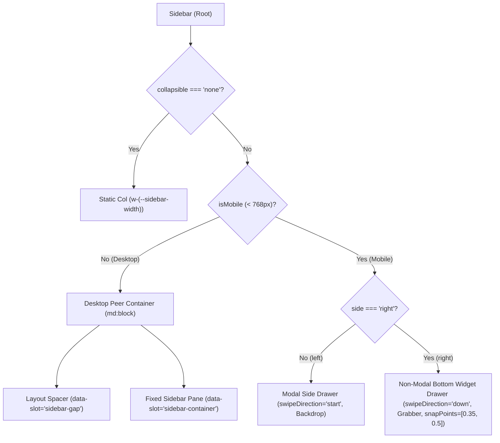
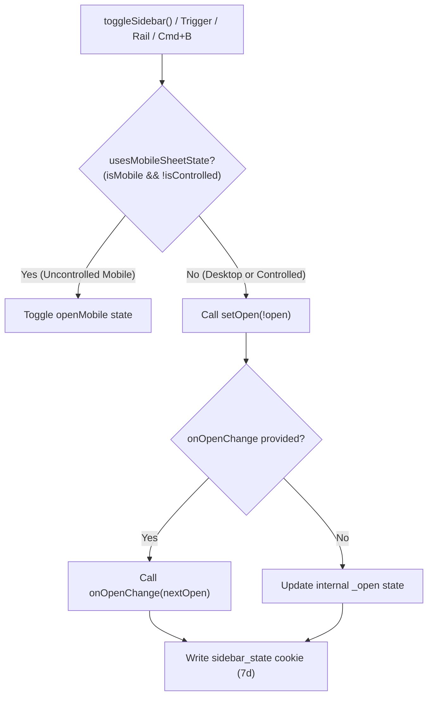
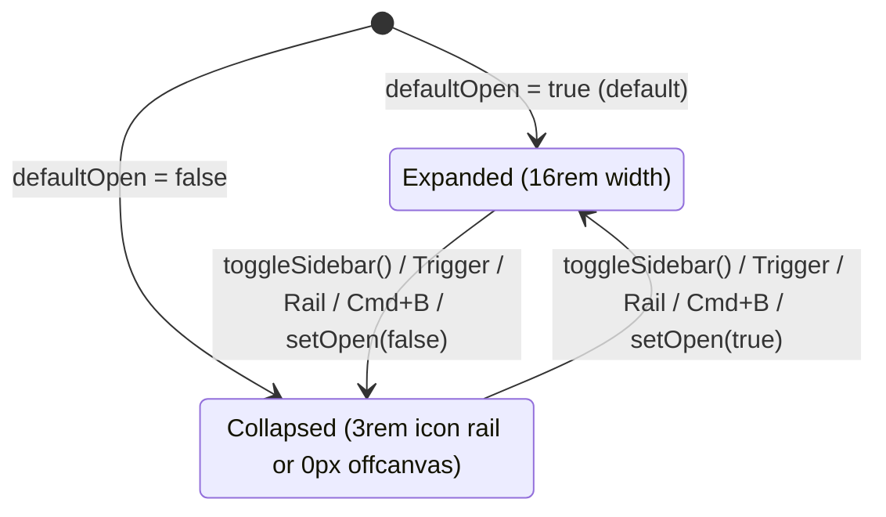
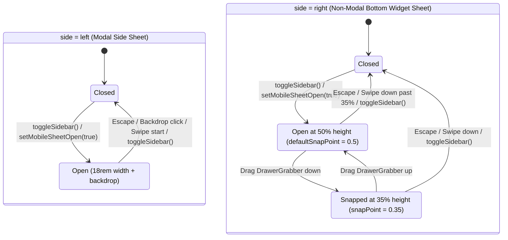

# Sidebar

## Overview

`Sidebar` provides a composable, themeable application navigation shell for `@cloudvoyant/helical-react` and `@cloudvoyant/helical-svelte`, sharing styles, variants, and constants from `@cloudvoyant/helical-ui`. It supports left and right placement, collapsing to an icon rail or off-canvas, nested layouts, and responsive mobile sheets built on Ark UI's `drawer` and `tooltip` primitives.

## Design

### Layout

```text
Desktop (>= 768px, side="left" + nested side="right"):
+-----------------------------------------------------------------------+
| [Sidebar (left)] | [Header: Trigger (left) ... Trigger (right)]       |
|  - Header        |----------------------------------------------------|
|  - Content       | [SidebarInset / Main Content]  | [Sidebar (right)] |
|  - Footer        |                                |  - Header         |
|  - Rail          |                                |  - Content        |
+-----------------------------------------------------------------------+

Mobile (< 768px):
  side="left"  -> Full-height modal side sheet (swipeDirection="start")
  side="right" -> Non-modal bottom widget sheet (swipeDirection="down",
                  grabber handle, snapPoints=[0.35, 0.5])
```



### Behavior

- **Default:** `SidebarProvider` starts collapsed (`defaultOpen = false`) on desktop and closed (`openMobile = false`) on mobile.
- **Interaction:** Clicking `SidebarTrigger`, clicking `SidebarRail`, or pressing `Cmd/Ctrl+B` toggles the active sidebar state. On mobile, `side="left"` swipes horizontally to dismiss and `side="right"` drags vertically via `DrawerGrabber` between `35%` and `50%` viewport height or down to dismiss.
- **Loading, empty, and error:** `SidebarMenuSkeleton` renders placeholder rows while navigation items load.
- **Accessibility:** Mobile sheets use Ark UI `DrawerRoot` for dialog semantics and `Escape` dismissal. Collapsed icon-rail buttons expose labels through Ark UI `Tooltip`. `SidebarTrigger` and `SidebarRail` are native `<button>` elements with `aria-label="Toggle Sidebar"`.

## Implementation

### Public API

- **`SidebarProvider`**: Owns open state and viewport breakpoint detection (`defaultOpen?: boolean`, `open?: boolean`, `onOpenChange?: (open: boolean) => void`).
- **`Sidebar`**: Renders the responsive container (`side?: 'left' | 'right'`, `variant?: 'sidebar' | 'floating' | 'inset'`, `collapsible?: 'offcanvas' | 'icon' | 'none'`).
- **Structural and menu parts**: `SidebarHeader`, `SidebarContent`, `SidebarFooter`, `SidebarGroup`, `SidebarGroupLabel`, `SidebarGroupAction`, `SidebarMenu`, `SidebarMenuItem`, `SidebarMenuButton`, `SidebarMenuLink`, `SidebarMenuAction`, `SidebarMenuBadge`, `SidebarMenuSkeleton`, `SidebarMenuSub`, `SidebarMenuSubItem`, `SidebarMenuSubButton`, `SidebarTrigger`, `SidebarRail`, `SidebarInset`, `SidebarSeparator`, `SidebarInput`, and `useSidebar`.

### State and Data Flow



#### Desktop State Transitions (`>= 768px`)

Driven by `open` (`state = 'expanded' | 'collapsed'`) and persisted to the `sidebar_state` cookie:



#### Mobile Sheet State Transitions (`< 768px`)

Driven by `mobileSheetOpen` (`openMobile` when uncontrolled, `open` when controlled; starts `Closed` in uncontrolled mode):



- **Uncontrolled mode (`open === undefined`)**: Desktop and mobile states are decoupled (`open` vs `openMobile`), matching shadcn's split so resizing across `768px` does not unexpectedly pop open a mobile overlay. Desktop state persists in the `sidebar_state` cookie.
- **Controlled mode (`open !== undefined`)**: `isControlled` is `true`, and a single `open` / `onOpenChange` pair drives both the desktop sidebar and the mobile drawer (`mobileSheetOpen = isControlled ? open : openMobile`). This allows parent layouts (such as nested sidebars with custom header triggers) to control a sidebar across breakpoints with one state variable.

### Styling and Responsiveness

- **Tokens and dimensions**: Uses `--sidebar-*` theme variables from `@cloudvoyant/helical-ui/src/theme.css` and shared width constants (`SIDEBAR_WIDTH = 16rem`, `SIDEBAR_WIDTH_MOBILE = 18rem`, `SIDEBAR_WIDTH_ICON = 3rem`).
- **Desktop transitions**: `sidebar-gap` reserves horizontal flex space while `sidebar-container` is `position: fixed`, transitioning `left`, `right`, and `width` over `200ms ease-linear`.
- **Mobile keyframe animations**: Defined in `@cloudvoyant/helical-ui/src/components.css` (`helical-drawer-in-left`, `helical-drawer-out-left`, `helical-drawer-in-down`, `helical-drawer-out-down`, `helical-fade-in`, `helical-fade-out`) and bound via `data-[state=open]` / `data-[state=closed]` utilities in `sidebarStyles`.

### Maintainer Notes

- **Why mobile drawer animations use `@keyframes` on `translate` in `components.css`**:
  1. Ark UI's `@zag-js/presence` machine inspects `getComputedStyle(node).animationName` when transitioning to `data-state="closed"` and waits for `animationend` before setting `hidden`. Plain CSS `transition-*` utilities report `animationName: none` and are unmounted immediately before the exit transition can play.
  2. Animating the standalone `translate` CSS property (rather than `transform`) composes cleanly with Zag's inline `transform: translate3d(var(--drawer-translate-x), var(--drawer-translate-y), 0)` swipe-drag styles.
- **Bottom-sheet drag isolation**: In the `side="right"` mobile widget drawer, `DrawerGrabber` is the only drag handle. The navigation body wrapper carries `data-no-drag` so pointer interactions on menu links do not initiate a sheet drag. Snap points (`SIDEBAR_WIDGET_SNAP_POINTS = [0.35, 0.5]`) are only passed when `isBottomWidgetSheet` is true; passing snap points to the full-height left sheet would park it partially off-screen.
- **RTL physical direction**: `DrawerRoot` receives logical `swipeDirection="start"` for `side="left"`, which Zag reports physically as `data-swipe-direction="left"` in LTR and `"right"` in RTL. If explicit RTL overrides are added to `mobilePositionerClass`, pair `data-[swipe-direction=left]` rules with `data-[swipe-direction=right]`.
