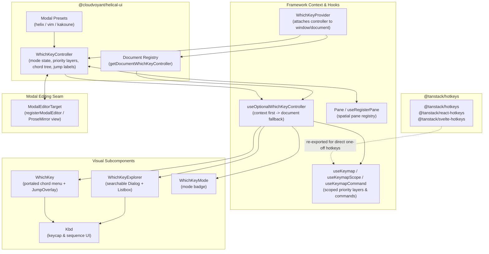
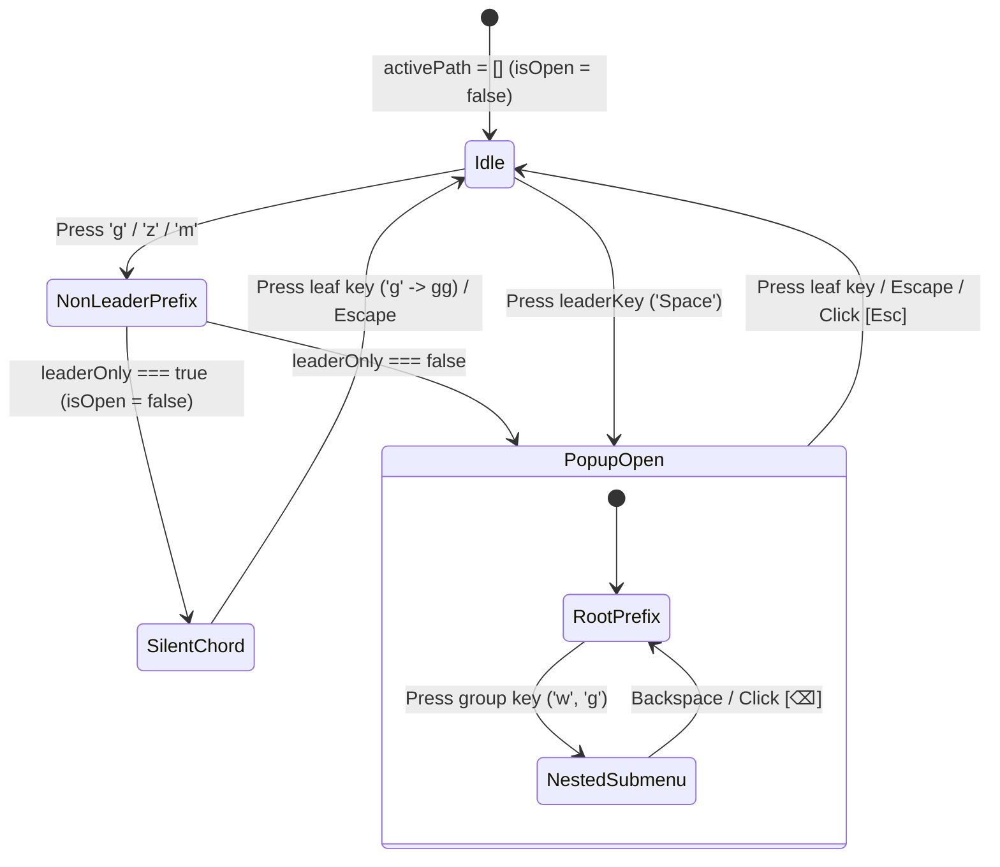
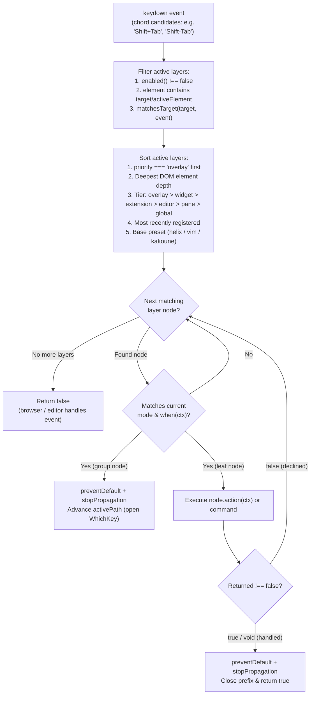
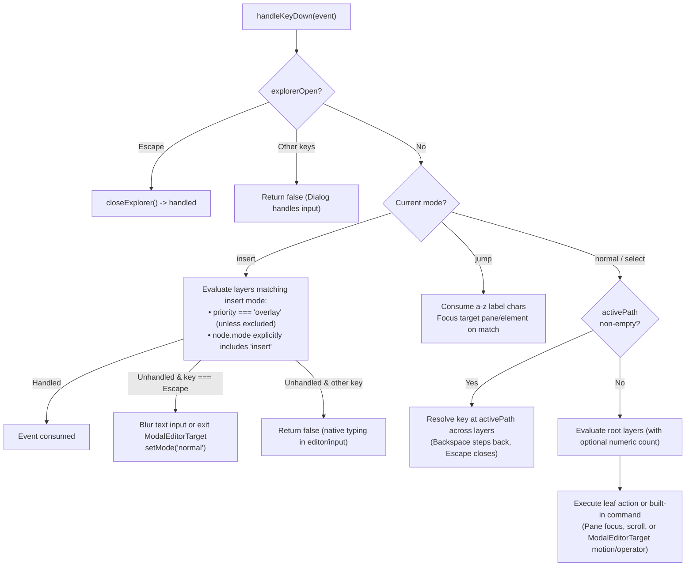

# WhichKey, WhichKeyExplorer, WhichKeyMode, and Kbd

## Overview

`WhichKey` is a Helix-inspired chord discovery menu and scoped hotkey system for `@cloudvoyant/helical-react` and `@cloudvoyant/helical-svelte`.

- **`WhichKey`**: Floating chord popup (`variant="helix" | "modern" | "classic"`) and 2D `JumpOverlay`.
- **`WhichKeyExplorer`**: Searchable `?` / `Space ?` modal listing all active keybindings by category.
- **`WhichKeyMode`**: Status badge showing the active mode (`normal`, `select`, `insert`, `jump`, or `·lock`).
- **`Kbd`**: Semantic `<kbd>` keycap and chord sequence renderer.

## Design

### Components and Wiring

`WhichKeyProvider` owns a `WhichKeyController` instance, registers it on `document` so portaled components can find it without prop drilling, and coordinates UI components, scoped `useKeymap` hooks, `@tanstack/*-hotkeys`, and optional ProseMirror modal editors.



| Part | Role |
| :--- | :--- |
| `WhichKeyController` | Holds modal state (`normal`, `select`, `insert`, `jump`), merges preset and registered keymap layers, and dispatches `keydown` events. |
| `WhichKeyProvider` | Creates or binds a controller, attaches `keydown` listeners, and registers the controller on `document`. |
| `useOptionalWhichKeyController` | Reads the nearest `WhichKeyProvider` controller or falls back to `getDocumentWhichKeyController(document)` for portaled overlays. |
| `useKeymap` / `useKeymapScope` | Registers a scoped keymap layer with a priority tier, optional DOM `element` boundary, reactive `enabled` flag, and `when` predicates. |
| `useKeymapCommand` | Binds a command handler ID (`'editor.save'`) invoked by leaf nodes in the keymap tree. |
| `@tanstack/*-hotkeys` | Re-exported alongside `WhichKey` so simple component hotkeys (`useHotkey`, `createHotkey`) work without a separate hotkey library. |
| `registerModalEditor` | Connects a rich-text editor (`ModalEditorTarget`) so `normal`/`select` motions, operators, and `insert` entry/exit drive editor selection and focus. |
| `Pane` / `useRegisterPane` | Registers focusable workspace panes for spatial navigation (`Space w h/j/k/l`) and 2-character jump labels (`gw`). |
| `WhichKey` / `WhichKeyExplorer` / `WhichKeyMode` | Purely visual subscribers that render the active chord submenu, searchable keybinding dialog, and current mode badge. |



### Layout

```text
WhichKey (variant="helix", bottom-right floating panel):
+-----------------------------------------------------------+
| Leader   Space » w                            [⌫]   [Esc] |
|-----------------------------------------------------------|
| Focus Left          [h]   | Focus Down                [j] |
| Focus Up            [k]   | Focus Right               [l] |
| Go to >             [g]   | Window >                  [w] |
+-----------------------------------------------------------+

WhichKeyExplorer (? / Space ? modal):
+-----------------------------------------------------------+
| Keybindings                                 18 bindings   |
| [Search keybindings...                                  ] |
|-----------------------------------------------------------|
| GOTO                                                      |
|   Go to top                                       [g] [g] |
|   Go to bottom                                    [g] [e] |
+-----------------------------------------------------------+
```

### Behavior

- **Lazy mount:** `<WhichKey />` mounts in a `<Portal>` only while a chord prefix is open, without stealing DOM focus.
- **Leader-only option (`leaderOnly`):** When `leaderOnly` is `true`, non-leader prefixes (`g`, `z`, `m`) run silently while `Space` opens the popup.
- **Layered keymaps and fallthrough:** Higher-priority and deeper DOM layers run first; if a binding's `when` check or `action` returns `false`, the key press falls through to the next layer or the browser.
- **Mode-aware keys:** `normal` and `select` modes run modal commands and multi-key chords, while `insert` mode evaluates only `overlay` layers and bindings that include `'insert'` before falling back to `Escape`.
- **Submenu navigation:** Clicking or pressing a group key opens its submenu, `Backspace` (`⌫`) steps back one level, and `Escape` (`Esc`) closes the popup.
- **Accessibility:** `WhichKey` renders `role="region"`, announces changes via `@zag-js/live-region`, and tracks `@zag-js/dismissable` branches so `Escape` closes `WhichKey` before parent dialogs.

## Implementation

### Public API

| Package | Public Exports |
| :--- | :--- |
| `@cloudvoyant/helical-ui` | `createWhichKeyController`, `getDocumentWhichKeyController`, `whichKeyVariants`, `kbdVariants`, `formatKeycap`, `formatHotkeySequence`, `WhichKeyNode`, `RegisterKeymapOptions`, `KeymapPriority`, `ModalEditorTarget`, and `@tanstack/hotkeys` re-exports |
| `@cloudvoyant/helical-react` | `WhichKeyProvider`, `WhichKey`, `WhichKeyExplorer`, `WhichKeyMode`, `Pane`, `Kbd`, `useWhichKey`, `useWhichKeyController`, `useOptionalWhichKeyController`, `useKeymap`, `useKeymapScope`, `useKeymapCommand`, `useRegisterPane`, and `@tanstack/react-hotkeys` re-exports |
| `@cloudvoyant/helical-svelte` | `WhichKeyProvider`, `WhichKey`, `WhichKeyExplorer`, `WhichKeyMode`, `Pane`, `Kbd`, `useWhichKey`, `useWhichKeyController`, `useOptionalWhichKeyController`, `useKeymap`, `useKeymapScope`, `useKeymapCommand`, `useRegisterPane`, and `@tanstack/svelte-hotkeys` re-exports |

### Priority Layer Resolution and Fallthrough

Each `registerKeymap` or `useKeymap` call registers an independent layer. On `keydown`, `WhichKeyController` sorts active layers from most specific to least specific and only consumes the DOM event when a matching node's `when(ctx)` predicate passes and its `action(ctx)` (or command handler) returns `!== false`.



### Mode Evaluation and Modal Editing Seam

`WhichKeyController.handleKeyDown` checks the active mode before dispatching chords or built-in editor commands. In `insert` mode, normal single-letter chords are bypassed so typing flows into the input or editor, while `overlay` layers (such as slash or mention menus) and explicit `mode: ['insert']` bindings still run first.



### Styling and Maintainer Notes

- **Theme tokens:** Uses semantic CSS variables (`--popover`, `--popover-foreground`, `--primary`, `--muted`, `--accent`, `--border`) from `libs/helical-ui/src/theme.css`.
- **Responsive touch guard:** Disables keyboard interception on coarse-pointer mobile viewports (`disableOnMobile = true` by default).
- **Dismissable branch tracking:** Both `WhichKey` and `JumpOverlay` register with `controller.trackBranchElement` (`@zag-js/dismissable`) while visible so nested `Escape` presses close `WhichKey` before any underlying `Dialog`.
