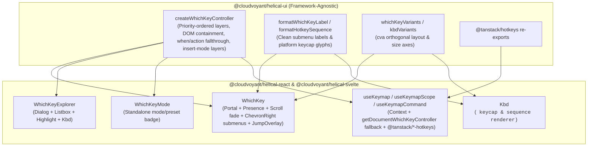
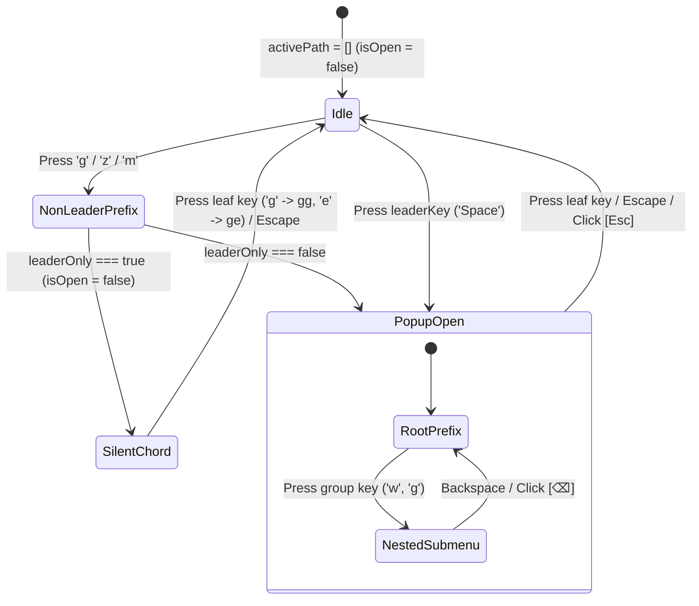

# WhichKey, WhichKeyExplorer, WhichKeyMode, and Kbd

## Overview

`WhichKey` is a Helix-inspired floating chord discovery panel that displays active multi-key prefix chords (`Space`, `g`, `z`, `m`, `Ctrl-w`) and their available child bindings in `@cloudvoyant/helical-react` and `@cloudvoyant/helical-svelte`. It is decoupled from keyboard mode concerns: keyboard mode and chord execution live in `WhichKeyController` (and are optionally surfaced via `<WhichKeyMode />`), whereas `<WhichKey />` is a purely visual chord menu and jump-label overlay.

- **`WhichKey`**: Portaled floating chord menu (`variant="helix" | "modern" | "classic"`), plus the 2D `JumpOverlay` when `mode === 'jump'`. Supports `leaderOnly` so consumers or users can choose whether the popup appears on all chord prefixes (`Space`, `g`, `z`, `m`) or only when the chord starts with `leaderKey` (`Space`).
- **`WhichKeyExplorer`**: Searchable `<leader>?` (`?`) modal (`Dialog` + `Listbox` + `Highlight`) listing all active bindings grouped by category with `<Kbd>` chord sequences.
- **`WhichKeyMode`**: Standalone status badge displaying the active modal state (`normal`, `select`, `insert`, `jump`, or `·lock`).
- **`Kbd`**: Semantic `<kbd>` keycap and multi-step sequence primitive powered by `formatKeycap` and `formatHotkeySequence`.

## Design

### Layout

```text
WhichKey (variant="helix", bottom-right floating panel):
+-----------------------------------------------------------+
| Leader   Space » w                            [⌫]   [Esc] |
|-----------------------------------------------------------|
| Focus Left          [h]   | Focus Down                [j] |
| Focus Up            [k]   | Focus Right               [l] |
| Go to >             [g]   | Window >                  [w] |
|-----------------------------------------------------------|
|               (scroll-fade bottom edge)                   |
+-----------------------------------------------------------+

WhichKeyExplorer (? / Space ? modal):
+-----------------------------------------------------------+
| Keybindings                                 18 bindings   |
| [Search keybindings...                                  ] |
|-----------------------------------------------------------|
| GOTO                                                      |
|   Go to top                                       [g] [g] |
|   Go to bottom                                    [g] [e] |
|   Jump to 2-char label                            [g] [w] |
+-----------------------------------------------------------+
```



### Behavior

- **Default:** `<WhichKey />` stays unmounted (`<Presence present={effectiveOpen} lazyMount unmountOnExit>`) while `activePath` is empty. When a prefix key with child bindings is pressed, `WhichKey` mounts in a `<Portal>` without stealing DOM focus.
- **Scoped Priority Layer Resolution & Conditional Fallthrough:**
  - `controller.registerKeymap(id, nodes, options)`, `useKeymap(nodes, options)`, and `useKeymapScope(scopeId, nodes, enabledOrOptions)` accept reactive `nodes` (`Record<string, WhichKeyNode> | (() => Record<string, WhichKeyNode>)`), reactive `enabled` (`boolean | (() => boolean)`), `priority` (`'overlay' | 'widget' | 'extension' | 'editor' | 'pane' | 'global'`), `element` (`HTMLElement | null | (() => HTMLElement | null)`), and `matchesTarget`.
  - On `keydown`, active layers are ordered by:
    1. `priority === 'overlay'` first (so portaled menus/popovers intercept keys while an editor holds focus)
    2. Innermost containing DOM `element` depth (`event.target` / `document.activeElement`)
    3. Priority tier (`overlay > widget > extension > editor > pane > global`)
    4. Registration recency (most recently registered layer wins ties)
    5. Base preset trie (`helix` / `vim` / `kakoune`) last
  - `event.preventDefault()` and `event.stopPropagation()` are called **only after** `node.when?.(ctx)` returns `true` and `node.action(ctx)` (or `executeCommand`) returns `!== false`. When `when` or `action` returns `false`, resolution falls through to the next matching layer (instead of clobbering lower layers in `mergeKeymapTrees` or swallowing the event) and finally to the editor or browser.
- **Insert-Mode Layer Evaluation:** Inside `mode === 'insert'`, before the default `Escape → setMode('normal')` transition and `return false`, `handleKeyDown` evaluates active registered keymap layers whose node `mode` explicitly includes `'insert'` (`nodeExplicitlyIncludesMode(node, 'insert')`). This allows editor overlays (`SlashMenu`, `MentionList`, popovers) and editor extensions to handle `Enter`, `Tab`, `ArrowUp`, `ArrowDown`, and `Escape` in `insert` mode without exiting `insert` mode until the overlay declines or closes.
- **Leader-Only Mode (`leaderOnly`):** When `leaderOnly` is `true` (via `WhichKeyProvider`, `controller.setLeaderOnly(true)`, or `<WhichKey leaderOnly />`), pressing non-leader prefixes such as `g`, `z`, or `m` keeps `isOpen` false so the popup does not appear, while `activePath` still advances and executes multi-key chords (`gg`, `ge`, `gw`, `zt`, `zz`). Pressing `leaderKey` (`Space`) opens the `WhichKey` popup as usual.
- **Interaction:** Submenu items render a clean label (`Go to`, `Window`, `View`, `Match`) followed by a `<ChevronRight />` icon (`data-group="true"`). Clicking an item or pressing its key advances `activePath` (for submenus) or invokes the leaf command and closes the prefix. Clicking `<Kbd>⌫</Kbd>` or pressing `Backspace` pops one prefix level (`stepBackPrefix()`); clicking `<Kbd>Esc</Kbd>` in the top-right header or pressing `Escape` closes the popup (`closePrefix()`).
- **Loading, empty, and error:** If a chord path has no matching items for the current mode, `isOpen` evaluates to `false` and the popup closes cleanly. In `WhichKeyExplorer`, unmatched queries render `<ListboxEmpty>` (`No keybindings found.`).
- **Accessibility:** `WhichKey` renders `role="region"` with `aria-label={title || 'WhichKey commands'}` and registers with `@zag-js/dismissable` (`trackDismissableBranch`) so pressing `Escape` dismisses `WhichKey` first without closing an underlying modal `Dialog`. State transitions are announced via a polite `@zag-js/live-region`.

## Implementation

### Public API

- **`@cloudvoyant/helical-ui`**: `createWhichKeyController`, `getDocumentWhichKeyController`, `subscribeDocumentWhichKeyController`, `nodeMatchesMode`, `nodeExplicitlyIncludesMode`, `whichKeyVariants`, `whichKeyBodyVariants`, `whichKeyHeaderBase`, `whichKeyTitleBase`, `whichKeyBreadcrumbBase`, `whichKeyItemBase`, `whichKeyItemLabelBase`, `whichKeyFooterBase`, `formatWhichKeyLabel`, `kbdVariants`, `kbdSequenceBase`, `formatKeycap`, `formatHotkeySequence`, `KeymapPriority`, `KeymapNodesInput`, `RegisterKeymapOptions`, `WhichKeyNode`, `WhichKeyProps`, `WhichKeyModeProps`, `WhichKeyExplorerProps`, `KbdProps`, plus `@tanstack/hotkeys` re-exports.
- **`@cloudvoyant/helical-react` & `@cloudvoyant/helical-svelte`**: `WhichKey`, `WhichKeyExplorer`, `WhichKeyMode`, `WhichKeyProvider`, `Pane`, `Kbd`, `useWhichKey`, `useWhichKeyController`, `useOptionalWhichKeyController`, `useKeymap`, `useKeymapScope`, `useKeymapCommand`, `useRegisterPane`, plus `@tanstack/react-hotkeys` and `@tanstack/svelte-hotkeys` re-exports.

### State and Data Flow



### Styling and Responsiveness

- Uses semantic tokens (`--popover`, `--popover-foreground`, `--primary`, `--muted`, `--accent`, `--border`) from `libs/helical-ui/src/theme.css`.
- Body uses `<Scroll viewportClassName="scroll-fade scroll-fade-12 no-scrollbar max-h-72">` with an empty `h-2` footer spacer (`whichKeyFooterBase`) for a subtle bottom scroll fade.
- Automatically disables keyboard interception on coarse-pointer / mobile viewports (`disableOnMobile = true` by default).

### Maintainer Notes

- **Separation of concerns:** `WhichKey` never renders mode badges or preset names; keyboard mode belongs to the hotkey controller and `<WhichKeyMode />`.
- **Portaled overlay discovery without prop-drilling:** `useKeymap`, `useKeymapScope`, `useKeymapCommand`, and `useOptionalWhichKeyController` fall back to `getDocumentWhichKeyController(document)` (which resolves the root controller or the active scoped `WhichKeyProvider` entry on the document) when called outside component context.
- **Dismissable layering:** Both the `WhichKey` panel and the `JumpOverlay` register with `controller.trackBranchElement` (`@zag-js/dismissable`) while visible so nested `Escape` handling respects open Ark `Dialog` layers.
