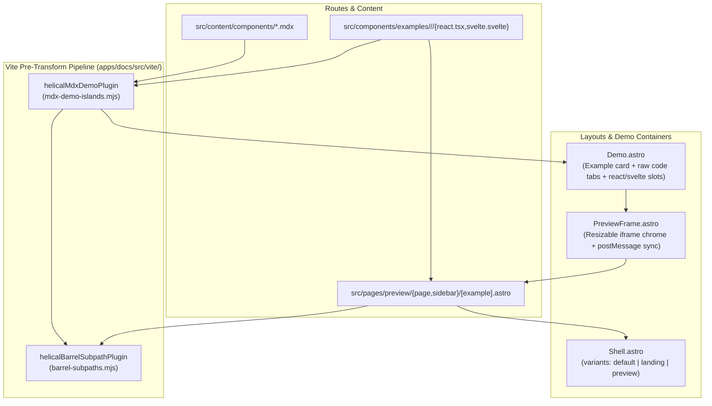
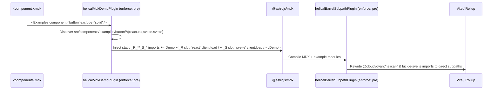
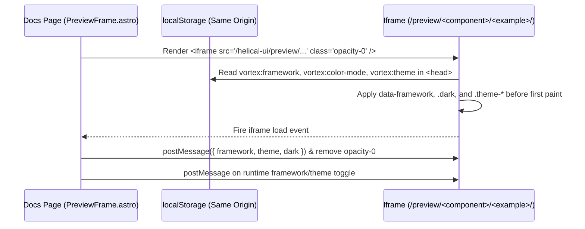
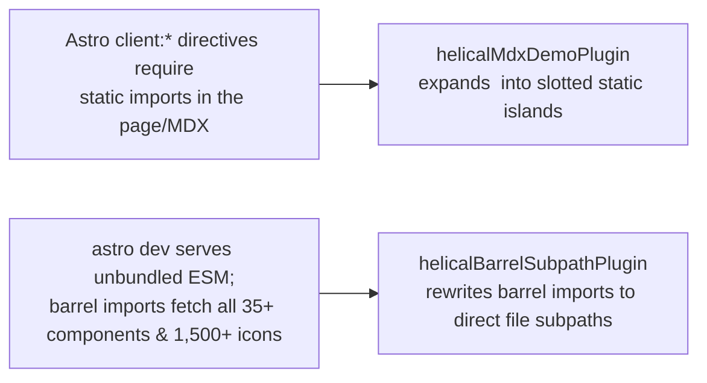

# Docs and demo site (`apps/docs`) — software architecture

## Overview

`apps/docs` is a private Astro 7 application that serves two roles:
1. Interactive documentation and side-by-side live demo showcase for `@cloudvoyant/helical-react` and `@cloudvoyant/helical-svelte`.
2. Playwright E2E test target verifying component rendering, keyboard navigation, ARIA states, and React/Svelte parity.

Non-goals: `apps/docs` is never published to npm (`"private": true`).

## Requirement

### Functional

- Author component pages in `.mdx` using concise `<Demo component="..." example="..." />` and `<Examples component="..." />` tags without manual per-page example imports.
- Render both React and Svelte live islands per demo card and switch between them instantly via `html[data-framework]`, persisting selection to `localStorage` (`vortex:framework`).
- Render viewport-dependent layout components (`page`, `sidebar`) inside isolated `<PreviewFrame>` iframes (`/preview/<component>/<example>/`) synced with the parent page's framework and theme.
- Support pure server-rendered (`SSR_EXAMPLES`) and client-only (`client:only`) demo modes alongside standard `client:load` islands.

### Non-Functional

- **Per-page bundle isolation:** Each page must load only the JavaScript and CSS for the components demonstrated on that page (no cross-page router bundles).
- **Fast dev navigation:** Cold page navigation in `astro dev` must not pull unselected workspace components or unused icon modules through barrel files.
- **Zero FOUC:** Both the main docs shell and preview iframes must restore theme, dark mode, and active framework in `<head>` before first paint, and hide preview iframes until loaded.

## Design

### Components and Responsibilities

- **`src/vite/mdx-demo-islands.mjs` (`helicalMdxDemoPlugin`):** Expands `<Examples>` and `<Demo>` in `.mdx` files before `@astrojs/mdx` runs, injecting static imports for only that page's examples and slotting `<_R_... slot="react" />` and `<_S_... slot="svelte" />`.
- **`src/vite/barrel-subpaths.mjs` (`helicalBarrelSubpathPlugin`):** Rewrites static named imports/exports from `@cloudvoyant/helical-{ui,react,svelte}` and `lucide-svelte` (plus Astro island `client:component-path` metadata) to concrete subpath files.
- **`src/layouts/Shell.astro`:** Unified HTML document shell supporting `variant="default"` (TopNav + Sidebar + Toc + Footer), `variant="landing"`, and `variant="preview"` (bare iframe canvas with `postMessage` sync).
- **`src/components/Demo.astro`:** Loads `?raw` source strings for code tabs and renders either `<PreviewFrame>` or the `react` and `svelte` named slots.
- **`src/components/PreviewFrame.astro`:** Renders an `<iframe data-preview>` with desktop/mobile width toggles, keeping the iframe `opacity-0` until `load` completes and syncing framework/theme changes via `postMessage`.

### Data and Control Flow

#### 1. MDX Demo Island Compilation (`helicalMdxDemoPlugin` + `helicalBarrelSubpathPlugin`)

#### 2. Preview Iframe Theme & Framework Synchronization

### Interfaces and Contracts

#### `helicalMdxDemoPlugin(options)`

| Option | Type | Default | Role |
| :--- | :--- | :--- | :--- |
| `previewFrameComponents` | `Iterable<string>` | `['sidebar', 'page']` | Left self-closing `<Demo />` so `Demo.astro` renders `<PreviewFrame>` instead of inline islands. |
| `ssrExamples` | `Iterable<string>` | `['mermaid/prerendered', 'latex/prerendered', 'code-block/prerendered', 'chart/prerendered', 'editor/server-reader']` | Slotted without `client:*` directives so Astro renders pure static HTML with zero client JS. |
| `clientOnlyComponents` | `Iterable<string>` | `['navbar']` | Slotted with `client:only="react"` and `client:only="svelte"`. |

## Implementation

### Why Both Vite Plugins Are Required

- **Why `helicalMdxDemoPlugin` cannot live inside `Demo.astro`:** Astro's compiler statically analyzes `client:load` and `client:only` directives at the call site where a component is imported. Dynamic `import.meta.glob('./examples/*/*/*')` inside `Demo.astro` either forces `eager: true` (bundling every example in the repository into every page) or loses Astro's per-island hydration boundary.
- **Why `"sideEffects": false` alone is not enough for `astro dev`:** Package-level `"sideEffects": false` enables Rollup tree-shaking during `astro build`, but `astro dev` serves unbundled ES modules directly to the browser. Without `helicalBarrelSubpathPlugin`, any `import { Button } from '@cloudvoyant/helical-react'` or `import { Check } from 'lucide-svelte'` forces Vite's dev server to crawl and transform the entire barrel graph on cold navigation.

### Adding a New Component Demo

1. Create `apps/docs/src/components/examples/<component>/<example>/react.tsx` and `svelte.svelte`.
2. Reference `<Demo component="<component>" example="<example>" />` or `<Examples component="<component>" />` in `apps/docs/src/content/components/<component>.mdx`.
3. If the component requires an isolated viewport iframe, add its route under `apps/docs/src/pages/preview/<component>/[example].astro` wrapped in `<Shell variant="preview">` and add `<component>` to `previewFrameComponents`.

## References

- [`apps/docs/astro.config.mjs`](../../apps/docs/astro.config.mjs)
- [`apps/docs/src/vite/mdx-demo-islands.mjs`](../../apps/docs/src/vite/mdx-demo-islands.mjs)
- [`apps/docs/src/vite/barrel-subpaths.mjs`](../../apps/docs/src/vite/barrel-subpaths.mjs)
- [`apps/docs/src/components/Demo.astro`](../../apps/docs/src/components/Demo.astro)
- [`apps/docs/src/components/PreviewFrame.astro`](../../apps/docs/src/components/PreviewFrame.astro)
- [`apps/docs/src/layouts/Shell.astro`](../../apps/docs/src/layouts/Shell.astro)
