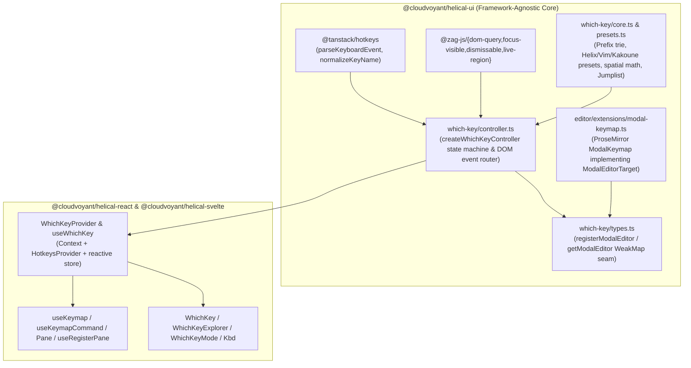

# Hotkey and Modal Editing System — software architecture

## Overview

The `helical-ui` hotkey and modal editing system provides framework-agnostic multi-key chord resolution, modal state management (`normal`, `select`, `insert`, `jump`), keybinding presets (`helix`, `vim`, `kakoune`), 2D spatial pane navigation, 2-character jump labels (`gw`), Jumplist history (`Ctrl-o` / `Ctrl-i`), and ProseMirror modal text editing across `@cloudvoyant/helical-ui`, `@cloudvoyant/helical-react`, and `@cloudvoyant/helical-svelte`.

## Requirement

### Functional

- **FR1 — Multi-Key Chord Trie & Presets:** Resolve single-key and multi-step prefix chords (`Space`, `g`, `z`, `m`, `[`, `]`, `Ctrl-w`) across selectable `helix` (default), `vim`, and `kakoune` presets, with runtime keymap layer merging (`registerKeymap` / `useKeymap`) and numeric count prefixes (`1..9`).
- **FR2 — Leader-Only Popup Filtering (`leaderOnly`):** Allow consumers and users to restrict the visual `WhichKey` popup to chords starting with `leaderKey` (`Space`) while keeping non-leader multi-key chords (`gg`, `ge`, `gw`, `zt`, `zz`) active.
- **FR3 — Spatial Pane Focus & Jumplist:** Support registering layout regions (`Pane` / `useRegisterPane`) for directional (`Ctrl-w h/j/k/l`), indexed (`Space 1..9`), and cyclic (`Ctrl-w w`) focus navigation, plus a bounded back/forward Jumplist (`Ctrl-o` / `Ctrl-i`).
- **FR4 — 2D Viewport Jump Labels (`gw`):** Generate collision-free prefix-free jump labels over visible interactive elements and either focus (`focus`) or click (`activate`) the matched target.
- **FR5 — Selection-First Modal Editing (`ModalKeymap`):** Provide Helix, Vim, and Kakoune motions, text objects (`miw`, `maw`, `mip`, `map`), selection transforms, and operators (`d`, `c`, `y`, `p`, `u`, `U`) inside the Tiptap/ProseMirror `Editor` via an inverted `ModalEditorTarget` seam.

### Non-Functional

- **NFR1 — Zero Framework Leakage in Core:** `libs/helical-ui/src/which-key/` must remain pure TypeScript with zero `react`, `svelte`, `@ark-ui/*`, or `@tiptap/*` runtime imports in the controller.
- **NFR2 — Scoped & Document Controller Coexistence:** Multiple scoped `WhichKeyProvider` instances (such as interactive documentation demos) must coexist with a document-level `WhichKeyProvider` without duplicate command execution.
- **NFR3 — Input & Overlay Safety:** Typing in native `<input>`, `<textarea>`, `contenteditable`, or open modal overlays (`CommandPalette`, `ColonCommand`, `WhichKeyExplorer`) must never trigger normal-mode single-key bindings.

## Design

### Components and Responsibilities



- **`which-key/core.ts` & `which-key/presets.ts`:** Pure functions for trie lookup (`resolveNode`, `buildWhichKeyTree`, `flattenKeymapEntries`), `helix` / `vim` / `kakoune` preset definitions, 2D directional cone scoring (`findDirectionalPane`), prefix-free jump label generation (`generateJumpLabels`), and `createJumplist`.
- **`which-key/controller.ts` (`createWhichKeyController`):** Owns runtime state (`preset`, `mode`, `leaderKey`, `leaderOnly`, `activePath`, `countBuffer`, `panes`, `jumpTargets`), capture-phase DOM listeners (`keydown`, `focusin`, `pointerdown`), and built-in command execution (`motion.*`, `pane.*`, `scroll.*`, `jump.*`, `tab.*`, `textObject.*`, `operator.*`).
- **`editor/extensions/modal-keymap.ts` (`ModalKeymap`):** Tiptap extension that registers its ProseMirror root element via `registerModalEditor(dom, target)` so `WhichKeyController` delegates motions, text objects, and operators to ProseMirror transactions when the editor is focused.

### Data and Control Flow

```mermaid
sequenceDiagram
  participant User as User Keyboard (keydown capture)
  participant Ctrl as WhichKeyController
  participant Trie as Preset + Custom Keymap Trie
  participant Target as Active Pane / ModalEditorTarget
  participant UI as WhichKey / WhichKeyMode

  User->>Ctrl: keydown event (e.g. 'g' then 'e', or 'Space' then 'w')
  Ctrl->>Ctrl: Check scope priority, editable element, & modal mode
  Ctrl->>Trie: Resolve candidate chord against activePath + effectiveMode
  alt Branch node (has children)
    Ctrl->>Ctrl: Append key to activePath; compute isOpen = !leaderOnly || activePath[0] === leaderKey
    Ctrl-->>UI: Emit WhichKeyState (renders WhichKey popup if isOpen)
  else Leaf node (commandId or action)
    Ctrl->>Target: Execute built-in / custom command or ModalEditorTarget operation
    Ctrl->>Ctrl: Reset activePath (unless sticky) & countBuffer
    Ctrl-->>UI: Emit WhichKeyState (closes popup)
  end
```

### Interfaces and Contracts

| Interface / Function | Location | Role |
| :--- | :--- | :--- |
| `WhichKeyController` | `libs/helical-ui/src/which-key/types.ts` | Imperative controller contract (`getState`, `subscribe`, `attach`, `handleKeyDown`, `setPreset`, `setMode`, `setLeaderOnly`, `setJumpAction`, `registerKeymap`, `registerCommand`, `registerPane`). |
| `WhichKeyState` | `libs/helical-ui/src/which-key/types.ts` | Immutable state snapshot (`preset`, `mode`, `leaderKey`, `leaderOnly`, `activePath`, `breadcrumb`, `items`, `isOpen`, `sticky`, `panes`, `jumpTargets`). |
| `ModalEditorTarget` | `libs/helical-ui/src/which-key/types.ts` | Inverted editor seam (`move`, `selectTextObject`, `transformSelection`, `execOperator`, `setModalState`). |
| `matchesCommandHotkey` | `libs/helical-ui/src/command.ts` | Standalone single-chord matcher wrapping `@tanstack/hotkeys`. |

## Implementation

### Scoped vs Document Controller Routing

When multiple `WhichKeyProvider` instances are mounted on the same document (for example, the site-wide `DocsWhichKeyProvider` with `scoped={false}` and per-demo `WhichKeyProvider` islands with `scoped={true}`):
- Clicking or focusing inside a `[data-which-key-scope]` container records that scope in `lastInteractedScopeByDoc`.
- Capture-phase `keydown` events inside that scope are handled exclusively by the scoped controller.
- Clicking outside any `[data-which-key-scope]` (or pressing `Escape` at the root of a scoped demo to exit back to the page) returns control to the document-level controller so page-level chords (`g`, `gg`, `ge`, `gw`, `Space`, `?`, `:`) work seamlessly.

### ProseMirror Modal Editing Seam

`ModalKeymap` (`libs/helical-ui/src/editor/extensions/modal-keymap.ts`) registers its DOM root in a global `WeakMap<Element, ModalEditorTarget>`. When `document.activeElement` is inside a registered editor:
- `isTextEntryElement` recognizes the editor while `onFocusIn` preserves `normal` or `select` mode when entering via keyboard navigation (`j` / `k` / `gw`).
- Motions (`h/j/k/l`, `w/b/e`, `0/$`, `gg/ge`), text objects (`miw`, `maw`, `mip`, `map`), and operators (`d`, `c`, `y`, `p`, `u`, `U`) execute directly against ProseMirror `TextSelection` and history commands.

## References

- [WhichKey Component Architecture (`components/which-key.md`)](components/which-key.md)
- [CommandPalette and ColonCommand Architecture (`components/commands.md`)](components/commands.md)
- [Monorepo Architecture (`index.md`)](index.md)
