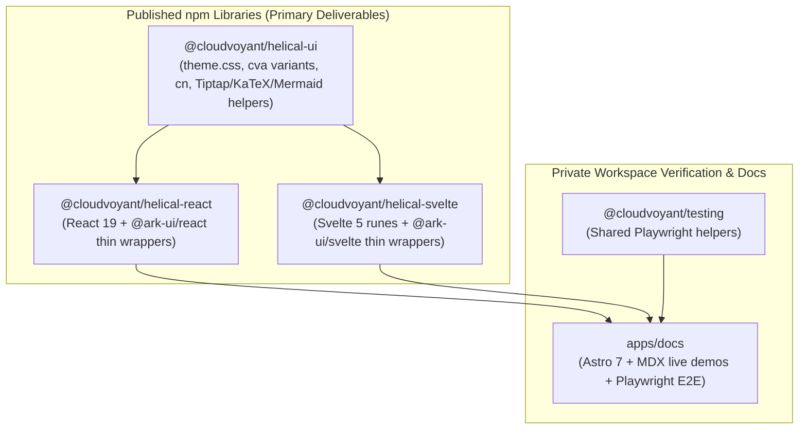
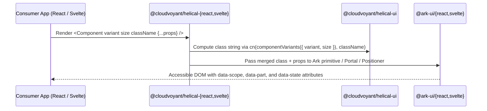
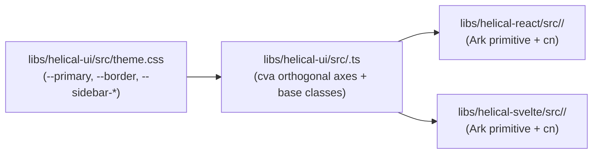
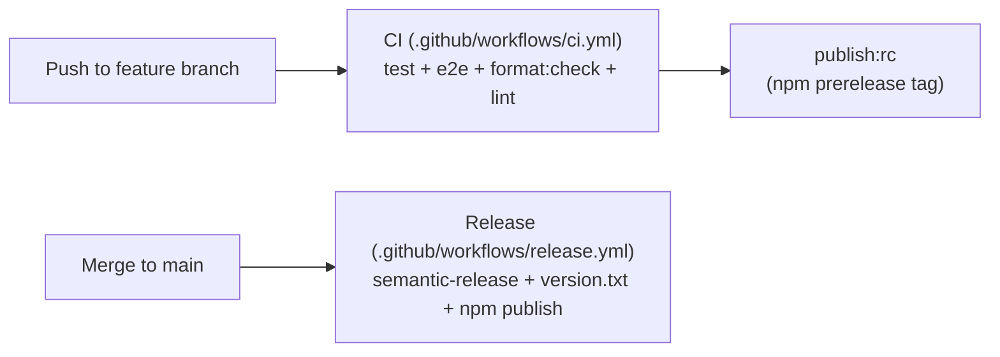

# helical-ui — software architecture

## Overview

`helical-ui` is a multi-framework UI component library monorepo. The primary deliverables are three published npm libraries (`@cloudvoyant/helical-ui`, `@cloudvoyant/helical-react`, and `@cloudvoyant/helical-svelte`) that share design tokens, `cva` variants, and prop contracts across React 19 and Svelte 5 on top of Ark UI primitives. `apps/docs` is a private Astro showcase and E2E test harness.

## Requirement

### Functional

- Provide framework-agnostic design tokens (`theme.css`, `themes.css`), `cva` variants, and pure state/helper logic in `@cloudvoyant/helical-ui`.
- Provide thin, prop-identical component wrappers for React 19 (`@cloudvoyant/helical-react`) and Svelte 5 runes (`@cloudvoyant/helical-svelte`) built on Ark UI state machines.
- Ship lockstep-versioned ESM/CJS/type bundles for all three libraries via semantic-release.
- Verify interactive accessibility and React/Svelte parity through Playwright E2E specs against `apps/docs`.

### Non-Functional

- **Tree-shakeability:** Library manifests declare `"sideEffects": false` (`["*.css"]` in `helical-ui`) and avoid namespace icon imports so consumer bundlers drop unused components and icons.
- **Zero framework leakage:** `@cloudvoyant/helical-ui` must never import `react`, `svelte`, or `@ark-ui/*`.
- **Theme & dark-mode parity:** Every component supports light and dark modes via CSS custom properties without runtime style injection.

## Design

### Components and Responsibilities

- **`libs/helical-ui` (`@cloudvoyant/helical-ui`):** Owns CSS design tokens (`src/theme.css`, `src/themes/*.css`), keyframe/third-party rules (`src/components.css`), `cn`, `cva` variant definitions, and framework-neutral rich-text/math/diagram logic.
- **`libs/helical-react` (`@cloudvoyant/helical-react`):** Thin `forwardRef` wrappers over `@ark-ui/react` primitives applying `cn(variants(...), className)`.
- **`libs/helical-svelte` (`@cloudvoyant/helical-svelte`):** Thin Svelte 5 runes (`$props`, `$derived`, `$state`) wrappers over `@ark-ui/svelte` primitives matching React props 1:1.
- **`libs/testing` (`@cloudvoyant/testing`):** Shared Playwright test utilities.
- **`apps/docs` (`docs`):** Private Astro documentation and side-by-side React/Svelte demo site. See [docs-site.md](docs-site.md).

### Data and Control Flow

### Interfaces and Contracts

| Package | Entry / Subpaths | Packaging Tool | `sideEffects` | Output Contract |
| :--- | :--- | :--- | :--- | :--- |
| `@cloudvoyant/helical-ui` | `.`, `./theme.css`, `./themes.css`, `./components.css` | `tsup` | `["*.css"]` | ESM + CJS + `.d.ts` + raw CSS |
| `@cloudvoyant/helical-react` | `.` | `tsup` | `false` | ESM + CJS + `.d.ts` |
| `@cloudvoyant/helical-svelte` | `.` | `@sveltejs/package` | `false` | ESM + `.svelte` + `.d.ts` |

## Implementation

### Component Anatomy Pattern

- **Simple components (`Button`, `Badge`):** Single wrapper forwarding props and `cn(variants(...), className)` to the native element or Ark root.
- **Composite components (`Select`, `Tabs`, `Combobox`, `Sidebar`):** Per-part exports matching Ark's anatomy (`Root`, `Trigger`, `Content`, `Item`, etc.).
- **Overlay components (`Popover`, `Dialog`, `Window`, `Tooltip`, `Toast`, `CommandPalette`, `CommandMenu`):** `Content`, `Backdrop`, and `Toaster` parts encapsulate Ark's `Portal` and `Positioner` internally so consumers compose only semantic parts; `CloseTrigger` is exported as `Dismiss` with a default `aria-label`.

### Architecture Index

- **Docs & Demo Site:** [docs/architecture/docs-site.md](docs-site.md)
- **Hotkey & Modal Editing System:** [docs/architecture/hotkeys.md](hotkeys.md)
- **Component Designs (`docs/architecture/components/`):**
  - [docs/architecture/components/sidebar.md](components/sidebar.md) — Sidebar layout, state transitions, and mobile sheet implementation.
  - [docs/architecture/components/commands.md](components/commands.md) — `CommandPalette` (`⌘K`) and `CommandMenu` (`:menu`) shared `TreeCollection` and `fzf` architecture.
  - [docs/architecture/components/which-key.md](components/which-key.md) — `WhichKey`, `WhichKeyExplorer`, `WhichKeyMode`, and `Kbd` component architecture.

### Release Pipeline

## References

- [Repository Guidance (`AGENTS.md`)](../../AGENTS.md)
- [Docs & Demo Site Architecture (`docs-site.md`)](docs-site.md)
- [Sidebar Component Architecture (`components/sidebar.md`)](components/sidebar.md)
