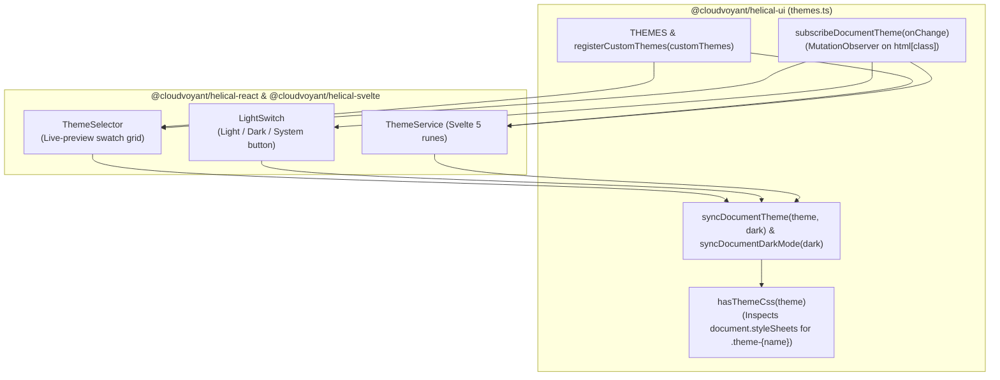
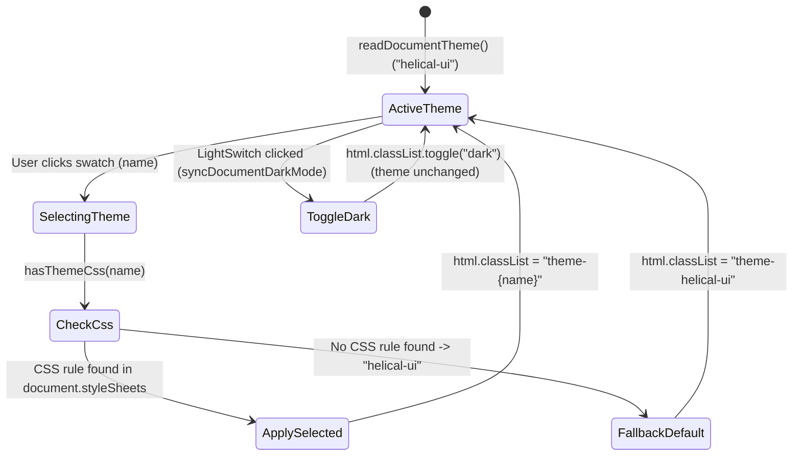

# ThemeSelector, LightSwitch, and Theme Registry

## Overview

`@cloudvoyant/helical-ui` provides a CSS-variable theme registry (`THEMES`, `registerCustomThemes`, `hasThemeCss`, `syncDocumentTheme`, `syncDocumentDarkMode`, `subscribeDocumentTheme`), paired with `ThemeSelector` and `LightSwitch` components in `@cloudvoyant/helical-react` and `@cloudvoyant/helical-svelte` (plus the reactive `ThemeService` / `themeService` store in `@cloudvoyant/helical-svelte`).

- **`ThemeSelector`**: Renders a 2-column scrollable grid of live-preview theme swatches. Each swatch applies its own `theme-{name}` class so its preview renders in that preset's palette, and selecting a swatch applies the theme class to `document.documentElement`.
- **`LightSwitch`**: Renders an icon button (`Sun` / `Moon` / `Monitor`) that cycles between `'light'`, `'dark'`, and `'system'` color modes and toggles `.dark` on `document.documentElement` without overwriting the active `theme-{name}` class.
- **`ThemeService` (`@cloudvoyant/helical-svelte`)**: A Svelte 5 runes store (`themeService`) that coordinates theme preset registration, light/dark mode cycling, OS media-query listeners, and `document.documentElement` synchronization.

## Design

### Layout

```text
ThemeSelector + LightSwitch:
+-------------------------------------------------------+
| Appearance                                     [☀/☾]  |
|-------------------------------------------------------|
| +-----------------------+  +-----------------------+  |
| | [====    ]          ● |  | [====    ]            |  |
| | [===     ]            |  | [===     ]            |  |
| | Helical UI            |  | Catppuccin            |  |
| +-----------------------+  +-----------------------+  |
| +-----------------------+  +-----------------------+  |
| | [====    ]            |  | [====    ]            |  |
| | [===     ]            |  | [===     ]            |  |
| | Cyberpunk             |  | Solar Flare (Custom)  |  |
| +-----------------------+  +-----------------------+  |
+-------------------------------------------------------+
```



### Behavior

- **Default:** `ThemeSelector` reads the active `theme-*` class from `document.documentElement` via `readDocumentTheme()` (defaulting to `'helical-ui'`) and renders all built-in `THEMES` (or `customThemes` merged ahead of `THEMES` via `registerCustomThemes`). `LightSwitch` reads the active `.dark` class from `document.documentElement` via `readDocumentDarkMode()`.
- **Interaction:** Clicking a swatch in `ThemeSelector` calls `syncDocumentTheme(name)`. Clicking `LightSwitch` cycles `mode` (`'light' -> 'dark' -> 'system'`) via `cycleThemeModeValue` and updates `document.documentElement`'s `.dark` class while keeping the current `theme-{name}` class intact.
- **Loading, empty, and error:** Before applying a theme to `document.documentElement`, `syncDocumentTheme` checks `hasThemeCss(theme)` across `document.styleSheets`. If a custom theme has no matching `.theme-{name}` CSS rule loaded in the document, `syncDocumentTheme` falls back to `'helical-ui'` (`DEFAULT_THEME`).
- **Accessibility:** Each swatch in `ThemeSelector` is a `<button type="button">` with `aria-pressed` set to `true` for the active theme and `title` set to the human-readable label. `LightSwitch` sets `aria-label="Theme: {mode}"` and `title="Theme: {mode}"`.

## Implementation

### Public API

#### `@cloudvoyant/helical-ui`

| Export | Signature | Description |
| :--- | :--- | :--- |
| `THEMES` | `ThemeMeta[]` | Built-in shadcn-compatible theme presets (including `'helical-ui'`). |
| `THEME_NAMES` | `string[]` | Array of built-in preset names. |
| `DEFAULT_THEME` | `'helical-ui'` | Fallback theme name when no theme or invalid CSS is provided. |
| `registerCustomThemes` | `(customThemes: readonly ThemeMeta[]) => ThemeMeta[]` | Prepends custom themes ahead of `THEMES`, deduplicating by `name` and injecting any `ThemeMeta.css` rules into `document.head`. |
| `hasThemeCss` | `(theme: ThemeName) => boolean` | Returns `true` when `.theme-{name}` rules exist in `document.styleSheets`. |
| `syncDocumentTheme` | `(theme: ThemeName, dark?: boolean) => ThemeName` | Applies `theme-{name}` (or falls back to `'helical-ui'` if `hasThemeCss` is `false`) on `document.documentElement` and returns the applied theme name. |
| `syncDocumentDarkMode` | `(dark: boolean) => void` | Toggles `.dark` on `document.documentElement` without changing the active `theme-*` class. |
| `readDocumentTheme` | `() => ThemeName` | Reads the active `theme-*` class from `document.documentElement`. |
| `readDocumentDarkMode` | `() => boolean` | Reads whether `document.documentElement` has the `.dark` class. |
| `subscribeDocumentTheme` | `(onChange: (state: { theme: ThemeName; dark: boolean }) => void) => () => void` | Observes `document.documentElement` class changes via `MutationObserver`. |
| `cycleThemeModeValue` | `(mode: ThemeMode) => ThemeMode` | Cycles `'system' -> 'light' -> 'dark' -> 'system'`. |
| `readSystemDarkMode` | `() => boolean` | Reads OS `prefers-color-scheme: dark`. |
| `subscribeSystemDarkMode` | `(onChange: (dark: boolean) => void) => () => void` | Subscribes to OS `prefers-color-scheme: dark` changes. |

#### `@cloudvoyant/helical-react` & `@cloudvoyant/helical-svelte`

| Component / Class | Props / Methods | Description |
| :--- | :--- | :--- |
| `ThemeSelector` | `value?`, `defaultValue?`, `themes?`, `onValueChange?`, `className?` / `class?` | Scrollable 2-column swatch grid that applies themes to `document.documentElement`. |
| `LightSwitch` | `mode?`, `defaultMode?`, `onModeChange?`, `className?` / `class?` | Standalone icon button that cycles light, dark, and system modes while preserving the active color theme. |
| `useTheme` | `useTheme(options?: UseThemeOptions): ThemeController` | Shared hook across `@cloudvoyant/helical-react` and `@cloudvoyant/helical-svelte` for registering custom themes and reading/updating active theme and dark mode. |
| `ThemeService` (`themeService`) | `theme`, `themeMode`, `darkMode`, `themes`, `registerCustomThemes()`, `setTheme()`, `setThemeMode()`, `cycleThemeMode()` | Svelte 5 reactive theme controller exported from `@cloudvoyant/helical-svelte`. |

#### Usage

```tsx
// React
import { HStack, LightSwitch, ThemeSelector, VStack, useTheme } from '@cloudvoyant/helical-react';

const CUSTOM_THEMES = [
  {
    name: 'solar-flare',
    label: 'Solar Flare',
    css: '.theme-solar-flare { --primary: oklch(0.65 0.22 42); --background: oklch(0.99 0.015 75); }',
  },
];

export function AppearancePanel() {
  useTheme({ customThemes: CUSTOM_THEMES });
  return (
    <VStack className="max-w-md gap-3">
      <HStack className="items-center justify-between">
        <span>Appearance</span>
        <LightSwitch />
      </HStack>
      <ThemeSelector />
    </VStack>
  );
}
```

```svelte
<!-- Svelte 5 -->
<script lang="ts">
  import { HStack, LightSwitch, ThemeSelector, VStack } from '@cloudvoyant/helical-svelte';
</script>

<VStack class="max-w-md gap-3">
  <HStack class="items-center justify-between">
    <span>Appearance</span>
    <LightSwitch />
  </HStack>
  <ThemeSelector />
</VStack>
```

### State and Data Flow



### Styling and Responsiveness

- Built-in theme presets live in `libs/helical-ui/src/themes/*.css` and are bundled via `@cloudvoyant/helical-ui/themes.css`.
- Each swatch scopes its preview using `class="theme-{name} [dark]"` and neutralizes `--font-sans` on the grid wrapper so custom theme fonts do not bleed across swatches.
- `themeSelectorContainerBase`, `themeSelectorGridBase`, `themeSelectorSwatchVariants`, and `lightSwitchButtonVariants` provide shared styling across React and Svelte.

### Maintainer Notes

- **Cross-instance synchronization:** Multiple `ThemeSelector` and `LightSwitch` instances on the same page stay synchronized without a shared React/Svelte context by observing `document.documentElement` class mutations through `subscribeDocumentTheme`.
- **E2E testing:** Theme selection, light/dark mode preservation, custom theme CSS registration, and missing-CSS fallback are verified in `apps/docs/e2e/theming.spec.ts` across React and Svelte islands.
